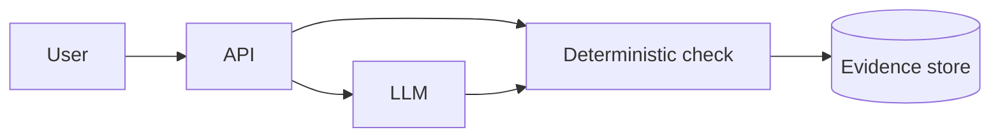

# codegeist-2026

**Agentic incident triage for Jira Service Management: the model proposes, deterministic code decides, nothing executes without a receipt.**

Built at codegeist-2026 · 2026-11-19 · Tracks: Apps for Software Teams + Best Agents (rovo:agent) + Best app with Atlassian MCP

**Live:** _not deployed yet_ · **Demo:** [90-second walkthrough](#the-90-second-demo) · **Limits:** [what doesn't work yet](#honest-limits)


---

## How codegeist-2026 meets the judging criteria

| Criterion | Points | How we meet it | Where to see it |
|---|---:|---|---|
| Technological Implementation | 20% | | §1 |
| Design | 20% | | §2 |
| Potential Impact | 20% | | §3 |
| Innovation/Idea | 20% | | §4 |
| Presentation | 20% | | §5 |

> Replace every cell with a specific, checkable claim and a link to where the judge can verify it.
> If a cell says something vague like "great UX", you have lost those points already.

---

## 1. Technological Implementation (20% pts)

### The problem, in numbers

| Number | What it means | Source |
|---|---|---|
| | | |

### Who it's for

### Before and after

| | Today | With codegeist-2026 |
|---|---|---|
| | | |

---

## 2. Design (20% pts)

### Architecture



### Results

_Measured, with provenance. No adjectives._

| Run | Metric | Value | How it was measured |
|---|---|---|---|
| | | | |

### The before/after progression

| Version | What changed | Result |
|---|---|---|
| v1 | | |
| v2 | | |
| v3 | | |

---

## 3. Potential Impact (20% pts)

---

## 4. Innovation/Idea (20% pts)

---

## 5. Presentation (20%)

See [VIDEO.md](../VIDEO.md) for the beat sheet.

---

## Track requirements

- **Forge platform + at least one Atlassian product:** how we satisfy it, and the file that proves it
- **rovo:agent module for the Best Agents bonus:** how we satisfy it, and the file that proves it

## Sponsor tech, in detail

| Sponsor | What we use it for | Where in the code |
|---|---|---|
| | | |

---

## The 90-second demo

| Step | Do | Watch for |
|---|---|---|
| 1 | | |
| 2 | | |
| 3 | | |
| 4 | | |

## Run it

```bash
./scripts/demo-up.sh       # one command, everything up
./scripts/demo-status.sh   # health
./scripts/demo-reset.sh    # back to a pristine demo state
./scripts/demo-down.sh
```

## For AI agents

Start with [`AGENTS.md`](AGENTS.md).

| Need | Where |
|---|---|
| Contracts and shared types | `contracts.ts` |
| Entry point | |
| Deterministic checks | |
| Demo seed data | `demo/seed/` |

## Repo map

```
contracts.ts     frozen types and API shapes
src/             application code
demo/            seed data + runbook
scripts/         demo + preflight tooling
docs/            architecture, screenshots
```

---

## Honest limits

_Name your own weaknesses here, before a judge finds them. This section wins points._

- **What is simulated:**
- **Sample size:**
- **What we did not build:**
- **Where it would break in production:**

## Sources

